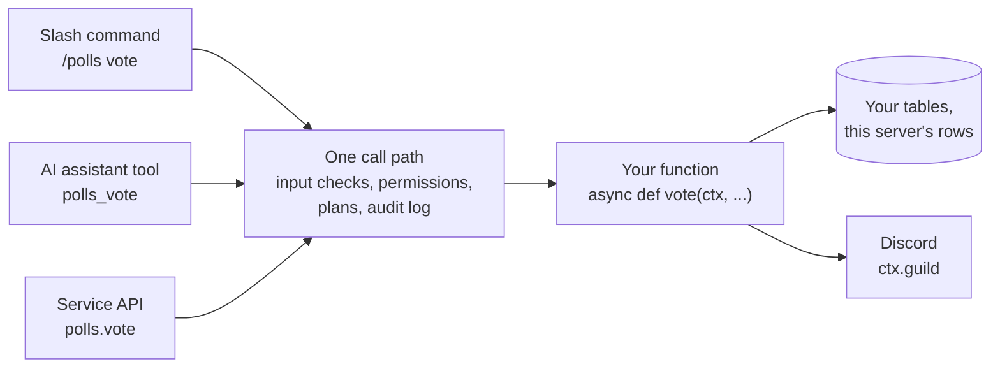

# Reference

Every part of a plugin, in one page. The table of contents on the right is its index. [Your first plugin](index.md) and the [tutorial](tutorial.md) show the same parts in use.

This covers `teabot.sdk` 1.x, which follows semantic versioning: a change that breaks plugins needs a new major version. Parts added after 1.0 say which release added them; a plugin that uses one depends on that release or later, as `teabot new-plugin` writes.

## How a plugin is reached



- One decorated function is a slash command, a tool for AI assistants, and an action in teabot's service API.
- Every call takes the same path. teabot checks the input against your function's parameters, checks the member's Discord permissions, shows a plan first for a destructive action, and records the call in the audit log. Only then does your function run.
- Your function works in one server at a time: `ctx.guild`, and the rows of that server in your own tables.

Worked examples are the plugins that ship with teabot, which import only `teabot.sdk` like yours: [giveaways](https://github.com/teabot-dev/teabot/blob/main/src/teabot/plugins/giveaways/__init__.py) (jobs, settings, a plan) and [announcements](https://github.com/teabot-dev/teabot/blob/main/src/teabot/plugins/announcements/__init__.py) (posting now and later).

## The package

- A plugin imports only `teabot.sdk`, and its tests only `teabot.sdk` and `teabot.testing`. Everything else in `teabot` is internal and may change in any release. `teabot check` and the test harness both refuse other imports.
- `pyproject.toml` declares an entry point in the `teabot.plugins` group, pointing at the plugin object. Its name must be the plugin's id:

    ```toml
    [project.entry-points."teabot.plugins"]
    raffles = "teabot_raffles:plugin"
    ```

- A plugin outside this repository depends on a compatible range of teabot, such as `teabot>=1.1,<2`.
- Ship a `py.typed` marker, and a `README.md` with an "External connections" section listing every host the plugin contacts, or "none".

## The plugin object

```python
from teabot.sdk import Context, Plugin

plugin = Plugin("raffles", config=RafflesConfig)
type Ctx = Context[RafflesConfig]
```

- `Plugin(id, *, config=EmptyConfig, migrations=None)`. The version comes from the installed package, and migrations from `migrations/` beside the module that made the plugin, unless `migrations` names another directory.
- The id matches `[a-z][a-z0-9_]{1,31}`. `core`, `admin`, `teabot`, `plugin`, `plugins`, `audit` and `tokens` are reserved. Two installed packages with the same id both fail to load.
- When the plugin loads, teabot imports every module of its package, so decorated functions in any module register themselves. It skips `tests`, modules whose names start with `_`, and `__main__`.
- Anything that fails while the plugin loads fails that plugin alone, which keeps none of its registrations. Everything else still loads.
- To run code at load, subclass `Plugin` and override `setup(registrar)`, calling `super().setup(registrar)`.

## Actions

```python
@plugin.action(risk=WRITE, needs="manage_guild")
async def draw(ctx: Ctx, channel: TextChannel, prize: Annotated[str, Field(max_length=100)]) -> Drawn:
    """Draw a raffle winner.

    Args:
        channel: Where to announce the winner
        prize: What the winner gets
    """
```

- `@plugin.action(*, risk=WRITE, needs=(), name=None, reply="private")`.
- The function's name is the action's name, so this is the slash command `/raffles draw`, the MCP tool `raffles_draw` and the service action `raffles.draw`. `name=` overrides it, and a trailing underscore is dropped, so `list_` is `list`.
- `risk` is `READ` (no side effects), `WRITE` (easy to undo) or `DESTRUCTIVE` (bulk or hard to undo). A destructive action needs a plan and always runs in two steps.
- `needs` is a Discord permission, or a tuple of them, by discord.py's name, such as `"manage_messages"`. The core checks it live on every call, and pyright checks the names.
- `reply="public"` shows the reply to the channel. Replies are private by default.
- The docstring's first line is the summary. Its `Args:` section describes every input, each in at most 100 characters. A missing entry fails the load and names the line.

### Inputs

Every parameter after the context is an input. Each may be optional (`X | None = None`) or have a default.

| Type | In Discord |
|---|---|
| `str`, `int`, `bool` | a text, number or true/false option |
| `Literal["a", "b"]`, or a `Literal` of ints | a choice |
| `LongText` | multi-line text, typed in a modal |
| `TextChannel`, `Role`, `Member` | a picker; the function receives the channel, role or member itself |
| `ChannelRef`, `RoleRef`, `MemberRef` | a picker; the function receives the Discord ID |
| `list[X]` of any of these but `LongText`, with `Field(max_length=...)` up to 10 | numbered options, such as `roles_1` to `roles_5`; MCP clients send an array |

- Limits go in `Annotated[int, Field(ge=1, le=20)]` or `Annotated[str, Field(max_length=100)]`. Discord enforces them before the member sends.
- A `TextChannel` that is missing or takes no messages, or a `Role` or `Member` not in the server, is refused with a message the member sees, and the function does not run.
- A list needs its `max_length`, and its `min_length` says how many of its options are required: `Annotated[list[Role], Field(min_length=1, max_length=5)]`. Lists were added in 1.3.
- Take a Discord ID as `Role`, `TextChannel`, `Member` or a `*Ref`, never as an `int`: Discord's number options stop at 2^53, and IDs are larger.
- An ID can be typed as the ID or as a mention, such as `<#123>`, which is what Discord inserts when someone types `#` or `@` in a text option or a setting.
- Any other type fails the load.

### Suggestions

Added in 1.3.

```python
@enter.autocomplete("giveaway")
async def running(ctx: Ctx, typed: str) -> list[Choice[int]]:
    rows = await ctx.db.fetch(Running, RUNNING, ctx.guild.id)
    return [Choice(f"{r.id}: {r.prize}", r.id) for r in rows if typed in r.prize]
```

- `@action.autocomplete("option")` suggests values for a `str` or `int` option, or a list of them, as the member types: up to 25 `Choice(name, value)`s, from what has been typed so far. A list's numbered options share it.
- Suggest an ID as a `str` value, such as `Choice(member.display_name, str(member.id))`, for the reason above. For channels, roles and members, Discord's own pickers already suggest, so an option of those types needs no suggester.
- It runs as the member, without the audit log, and must answer within Discord's three seconds. When the action would be refused, or the function fails or is slow, the member sees no suggestions.
- One function can suggest for several actions: stack the decorators.

### Outputs

- An action returns a Pydantic model, a list of models, or a `str`.
- In Discord a model is shown through its `render()` method if it has one, and otherwise as an embed of its fields. A list is shown one line per item, and a string as written.
- Without a `render()`, values show by their type: a `datetime` as a Discord timestamp, in each viewer's own time zone; a `ChannelRef`, `RoleRef` or `MemberRef` as a mention; `True` and `False` as yes and no. Added in 1.4.
- Mark text that members wrote as `UntrustedText`, which MCP clients receive wrapped as data.
- To tell the member what went wrong, raise `ActionError("That raffle has ended.")`. The message is shown as written and recorded in the audit log. Any other exception shows a generic reply and keeps its details in the audit log.

### Plans

```python
@cancel.plan
async def plan_cancel(ctx: Ctx, raffle: int) -> Diff:
    entries = await ctx.db.fetch(Entry, ENTRIES, ctx.guild.id, raffle)
    return Diff(entries=[DiffEntry(change="remove", target=e.name, key=e.id) for e in entries])
```

- A destructive action's plan takes the same inputs and returns a `Diff` of what it would change. Without a plan the load fails.
- The member sees the plan and confirms it within 15 minutes. If what it shows has changed by then, they get a fresh plan, marked stale, instead.
- The action then runs as a job and reads the confirmed plan as `ctx.diff`. An entry's `key` carries what the apply needs, such as a row id, so it changes exactly what the member saw.
- A destructive action returns a model, a list or a string like any other, but the member does not see it: they see the plan, then a reply that follows the change as it applies, ending with `Done.` Report how far it has got with `await ctx.report({"done": 3, "total": 10})`, which that reply shows as `3 of 10`, and `/admin job_status` too. Other keys show as they are, such as `{"cleared": 3}` as `cleared 3`.

## The context

`ctx` is for one server:

- `ctx.guild`: the server, as a `Guild`. `get_text_channel(id)`, `get_channel(id)`, `get_role(id)` and `await get_member(id)` find things in it, or return `None`. [Working with the server](#working-with-the-server) lists what else it does.
- `ctx.actor`: who asked. `user_id` is the member, `via` how the call came in (`"slash"`, `"component"` for a button, a select menu or a confirmation, `"mcp"`, `"service"`, `"job"`, or `"event"`), and `token_id` the token for MCP and service calls. In a job, it is the member who scheduled it; in an event, and a job nobody scheduled, it is `SYSTEM`.
- `ctx.config`: the plugin's config for this server, as the plugin's own model.
- `ctx.db`: the plugin's database, as its own role in its own schema.
- `ctx.now`: the time. Read the clock only through it, since tests move it.
- `ctx.diff`: in a destructive action's apply, the confirmed plan, and an empty `Diff` everywhere else.
- `await ctx.report(progress)`: progress for `/admin job_status`.

To post, send to a `TextChannel`:

```python
await channel.send("**A pet** goes to <@123>.", ping=[123])
await channel.send(embed=discord.Embed(title="Results"))
```

- Messages mention nobody unless you name members with `ping=`.
- A channel the bot may not post in raises an `ActionError` that says so.
- `files=[File("results.csv", data)]` attaches files.
- A post that goes with database writes, such as a draw's winners, goes through the transaction instead, with `tx.send`. See [Posting with a transaction](#posting-with-a-transaction).

## Working with the server

Added in 1.3, except finding channels, roles and members, and sending.

Every operation acts with the bot's own power, so **the plugin decides who may use it**: through the action's `needs=`, and its own checks where it lets members do something they could not do in Discord themselves, as the [roles plugin](https://github.com/teabot-dev/teabot/blob/main/src/teabot/plugins/roles/__init__.py) does. Before calling Discord, each operation refuses what Discord would, with an `ActionError` the member can read, such as "Raids is at or above my highest role".

| On | Read | Do |
|---|---|---|
| `Member` | `name`, `display_name`, `roles` (highest first), `top_role`, `role_ids`, `joined_at`, `avatar_url`, `bot`, `timed_out_until` | `add_role`, `remove_role`, `set_nickname`, `timeout(timedelta)` up to 28 days, `remove_timeout`, `kick`, `send` a direct message |
| `Role` | `name`, `position`, `permissions` (as `needs=` names them), `colour`, `managed`, `mentionable`, `hoisted` | |
| `Guild` | `name`, `icon_url`, `owner_id`, `member_count`, `me` (the bot), `roles`, `channels` (any kind, each with its `kind` and `parent_id`) | `find_members(prefix)`, `ban(user_id, delete_message_days=)`, `unban`, `bans()` |
| `Message` the bot sent | `id`, `channel_id`, `jump_url` | `edit`, which replaces its text, embed, buttons and files; `delete` |
| `TextChannel` | `name`, `mention` | `send`, `get_message(id)` for one of the bot's own posts |

- Every change takes `reason=`, which Discord's audit log shows. Without one, it says which action asked and for whom.
- The bot cannot manage a role at or above its own highest role, a managed role, or a member who outranks it, and it cannot kick, ban or rename the server's owner.

## Buttons and select menus

Added in 1.3.

```python
await channel.send(
    "**Pick your pings**",
    buttons=[Button(toggle.bind(role=raids), label="Raids", emoji="🗡️", style="primary")],
)
```

- `action.bind(...)` fixes an action's arguments, checked by pyright against its function. A `Role`, `TextChannel` or `Member` is kept as its ID.
- A `Button` runs the bound action as the member who presses it, through the same path as a slash command: `needs=` is checked against the presser, the call is audited, and a destructive action shows its plan.
- The call is held in the button itself, so a button keeps working after a restart, and needs nothing stored. It must fit Discord's 100 characters: bind IDs, never long text.
- A post holds up to 25 buttons, five to a row. `style` is `"primary"`, `"secondary"` (the default), `"success"` or `"danger"`.
- `Select(action.bind(...), into="roles", ...)` is a select menu: of `Option`s, filling a `list[str]` parameter, or with `kind="role"`, `"channel"` or `"member"`, Discord's own pickers, filling a list of those. The parameter it fills needs a default, such as `= None`, since `bind` leaves it out. A post holds one menu and up to 20 buttons.
- A press's reply is private unless the action says `reply="public"`.
- An action only its buttons and menus should reach takes `@plugin.action(surfaces=Surface.COMPONENT)`: it is then no slash command and no MCP tool. The roles plugin's `toggle` is one.
- Discord's own role, channel and member pickers cannot be limited to some roles. To offer a chosen few, use a menu of `Option`s whose values are the IDs, as strings.
- A menu's options are fixed when it is posted, and a post can outlive the roles or settings it was made from, so the action checks the choices again when it runs.

## Member events

Added in 1.3.

```python
@plugin.on_member_join
async def welcome(ctx: Ctx, member: Member) -> None:
    await member.send(f"Welcome to {ctx.guild.name}!")


@plugin.on_member_leave
async def farewell(ctx: Ctx, user: User) -> None:
    await channel.send(f"{user.name} has left.")
```

- They run in the servers where the plugin is enabled, as the bot: `ctx.actor` is `SYSTEM`, with `via` `"event"`.
- Each runs as one of the plugin's jobs, `on_member_join` or `on_member_leave`, so a failure is retried, up to three attempts, and shows in `/admin job_status`. A member who has left again by the time a join runs is skipped.
- A leave gets a `User`, with the `id` and the `name` they had, since they are no longer a member to look up.

## The database

- The plugin owns the schema `plugin_<id>` and a role that can use nothing else. Name tables without a prefix. Reading the core or another plugin's tables fails.
- Every table has a `bigint guild_id` column, and the migration runner refuses tables without one. That is how the core deletes a server's data when the bot leaves it.
- A column holding members' Discord IDs has the type `teabot.member_id`, or `teabot.member_id[]` for a list. That is how `teabot users delete` finds a member's rows when they ask for their data to be deleted: a row with them in such a column is deleted, and they are taken out of a list. teabot refuses a `bigint` column named for members, such as `member_id`, `user_id` or `winner_ids`, and names the type to use.
- Plugin code sees only the current server's rows. teabot holds every table to the server the action or job is for, so a query without `WHERE guild_id = ...` still reads and changes only that server's rows. An insert may leave `guild_id` out, and teabot fills it in; an insert naming another server is refused. Writing `WHERE guild_id = $1` with `ctx.guild.id` anyway keeps the query clear, and lets Postgres use an index on `guild_id`.
- Migrations run as the plugin's owner role, which sees every server's rows, so a migration can fill in a new column everywhere. Plugin code runs as a second role, which cannot create tables or other objects.
- A foreign key includes `guild_id`, so a row cannot point at another server's row. A unique index includes `guild_id` unless one of its columns is unique on its own. teabot checks these when the plugin loads, along with no views and no `SECURITY DEFINER` functions, and a broken rule stops the load with what to write instead.
- Queries take the result type first: `fetch(Model, sql, ...)` returns a list of models, `fetchrow(Model, sql, ...)` a model or `None`, and `fetchval(int, sql, ...)` one value. Each row is validated. `execute(sql, ...)` returns Postgres's status, such as `"INSERT 0 1"`.
- Each call runs exactly one statement. Pass values as parameters (`$1`, `$2`), never by building strings.
- Writes that belong together go in a transaction block, and everything inside it goes through `tx`:

    ```python
    async with ctx.db.transaction() as tx:
        raffle = await tx.fetchval(int, INSERT_RAFFLE, ctx.guild.id, prize, ends_at)
        await tx.schedule(announce_winner.bind(raffle=raffle), at=ends_at)
    ```

    - A job queued with `tx.schedule`, and a post sent with `tx.send`, commit together with the writes.
    - Calling `ctx.db` inside an open block raises, because it would miss the block's writes.
    - Never await Discord or HTTP inside a block. It holds a connection and its locks across a slow call. `tx.send` is not a Discord call: it stores the post, which teabot sends after the commit.
- Use `now()` in SQL for the time, never `CURRENT_TIMESTAMP`, since tests move `now()`.
- Never build dynamic SQL from member input in a plpgsql function (`EXECUTE`). It is the one way an injection bug could reach another plugin's data.
- Never block the event loop. Use async libraries for any I/O.

### Posting with a transaction

```python
async with ctx.db.transaction() as tx:
    await tx.execute(MARK_WON, ctx.guild.id, raffle, winners)
    post = await tx.send(channel_id, f"**{prize}** goes to <@{winner}>.", ping=[winner])
    await tx.execute(SAVE_POST, ctx.guild.id, raffle, post.id)
```

- `tx.send(channel, ...)` takes a `TextChannel` or a channel ID, and the same `content`, `embed=`, `ping=`, `buttons=` and `select=` as `channel.send`. Files are not sent this way.
- The post goes out a moment after the commit, and never if the block rolls back. teabot retries it while Discord is down.
- It goes out once. teabot sends it with a nonce, so Discord drops a retry within a few minutes. Only a retry after a long outage or a restart could post it twice.
- `tx.send` returns a `Post`. Store `post.id` to change it later with `tx.edit(post, ...)`, which replaces what it shows, or `tx.delete(post)`. An edit before it has gone out changes what goes out. `Post(row.post_id)` and the plain ID both work.
- A channel the bot may not post in, or one that is gone, does not fail the block. teabot records it on the post and does not retry.
- Use `channel.send` when the action needs the message straight away, such as to reply with its link, or to tell the member at once that the channel refuses posts.
- In tests, `harness.call`, `press` and `choose` send the posts an action queued before they return, so a test checks `channel.sent` straight after. `harness.run_jobs()` sends a job's posts too.

## Migrations

- `migrations/0001_<name>.sql`, `0002_<name>.sql` and so on, numbered from 1 with no gaps. Each runs once, in its own transaction, as the plugin's role.
- Migrations only go forward. Never edit one that has been released, since the runner refuses a changed file.
- Keep the previous release working: add columns and tables in one release, and drop them in a later one.

## Config

- A Pydantic model, passed as `Plugin(..., config=Model)`. Server admins set it with `/plugins config plugin:raffles setting:<name> value:<value>`. Without a setting, the command shows the current values. A value is read as JSON when it is JSON (numbers, `true`, `false`), and as the text typed otherwise, then validated through the model.
- Give every field a default, so a server that has set nothing still works.
- For a channel, role or member setting, use `ChannelRef`, `RoleRef` or `MemberRef`. An admin types `#`, `@` or the ID, and Discord's suggestions insert the mention, which the field accepts.
- The plugin never writes to its config. Anything the plugin writes goes in its tables.
- Change it only in ways older stored config still validates: new fields with defaults, `AliasChoices` for renames, `extra="ignore"` for removals, `model_validator(mode="before")` for anything else.
- Keep stored samples from earlier versions in `tests/fixtures/` and test that they still validate.

## Jobs

```python
@plugin.job
async def announce_winner(ctx: Ctx, raffle: int) -> None:
    ...
```

- A job's parameters after the context are its payload. It is stored as JSON, so give them types that survive the trip, such as `int`, `str`, `bool`, `Literal`s, and lists, optionals and models of them.
- `announce_winner.bind(raffle=3)` fixes the arguments, checked by pyright. `tx.schedule(bound, at=when)` queues it for this server, or as soon as possible without `at`.
- A job's key is its name and arguments. Scheduling the same bound job again moves it instead of adding another, and `tx.unschedule(bound)` removes it. `key=` sets a key of your own instead.
- The job's name is the function's name, and queued jobs are stored by it. To rename the function, keep the stored name with `@plugin.job(name="old_name")`.
- In a job, `ctx.actor` is the member who scheduled it and `ctx.config` is the server's config when it runs. If the bot has left the server, the job is dropped.
- A job can run twice: after a crash, its lease runs out and another worker takes it. Check state first, so that a second run changes nothing, and test it with `harness.run_job`.
- A failing job is retried after 2, 4, 8 and 16 seconds, five attempts in all, then stays failed with its error, which `/admin job_status` shows. Raise `ActionError` to give that error in your words.

## Testing

- The scaffold's `pyproject.toml` sets the tests up: it depends on `teabot[testing]` and adds `-p teabot.testing.fixtures` to pytest's options. Run them with `uv run --package teabot-<id> pytest plugins/<id>`.
- They need the instance's Postgres, which `setup.sh` starts, and read its password from the instance's `.env`. If Postgres is not reachable, the run stops at once and says what to start.
- `teabot_harness` loads the plugin through the real loader and migrations into a fake server:

    ```python
    async def test_draw_announces_a_winner(teabot_harness: HarnessFactory) -> None:
        harness = await teabot_harness(plugin)
        channel = harness.guild.add_channel(FakeChannel())
        out = await harness.call(draw, channel=channel, prize="A pet")
    ```

- The harness runs `teabot check` on the plugin's package when it loads it, and raises `CheckFailed` with each problem.
- Everything a test needs is in `teabot.testing`: `HarnessFactory`, the type of the `teabot_harness` fixture; `PluginHarness`, what it returns; the fakes; and `Refused`, `ActionFailed`, `JobFailed`, `CheckFailed` and `Planned`.
- Pyright checks the calls against your functions. Editors such as VS Code run it as you type; from a terminal, run `uv run --package teabot-<id> --with pyright pyright plugins/<id>`.

| Helper | What it does |
|---|---|
| `harness.call(action, ...)` | runs an action through the real call path, permissions and audit included, as the server's owner, its first member, who has Administrator; returns what the function returned |
| `harness.as_member(member).call(...)` | the same, as another member; `.plan(...)` too |
| `harness.plan(action, ...)` | a destructive action's `Planned` |
| `harness.confirm(plan)` | confirms the plan and runs the apply |
| `harness.run_jobs()` | runs every due job through the real worker; a failure raises `JobFailed` with the job's exception as its cause |
| `harness.press(message.buttons[0])` | presses a button on a fake message, through the real call path, returning the reply the member sees; `as_member(m).press(...)` presses as someone else |
| `harness.choose(message.select, values)` | chooses from a select menu: option values, or roles, channels or members |
| `harness.join(member)`, `harness.leave(member)` | fire a member joining or leaving, and run the jobs they queue |
| `harness.autocomplete(action, "option", typed)` | the suggestions a member sees after typing `typed`; `as_member(m).autocomplete(...)` as someone else, who sees none if they may not run the action |
| `harness.run_job(job.bind(...))` | runs the job now, as if scheduled again; use it after the job's first run, then check that nothing changed again |
| `harness.advance(minutes=...)` | moves the clock for `ctx.now`, `now()` in the plugin's SQL, and when jobs fall due; the jobs then due run at the next `run_jobs` |
| `harness.configure(Cfg(...))` | stores the server's config, as an admin would |
| `harness.invoke(name, raw)` | calls by name with raw input, as a front door would; for testing refusals of bad input |
| `harness.admin` | a connection that can read every table, for checking what a test wrote |

- `harness.guild.add_channel(FakeChannel())` adds a channel, whose `sent` lists what was posted. `FakeChannel(forbidden=True)` refuses to send, and `FakeVoiceChannel` takes no messages.
- `harness.guild.add_member(permissions, roles=[...], cached=False)` adds a member, found only over REST when `cached=False`. The fake member records what the bot did to it: its `roles`, `nick`, `timed_out_until`, `kicked`, the `dms` it was sent, and every `reasons` given.
- `harness.guild.add_role(name, position=, permissions=, managed=)` adds a role, above the test's other roles and below the bot's, at position 100, unless `position` says otherwise.
- A fake message keeps its `buttons`, `select`, `attachments`, how many `edits` it had, and whether it was `deleted`. `harness.guild.banned` holds the bans.
- The harness's first member owns the server and has Administrator, so it may do anything; give a test member only the roles and permissions the test is about. `add_member(..., bot=True)` adds a bot.
- To read the docstrings of `teabot.testing`, run Python in the plugin's own environment, which has pytest: `uv run --package teabot-<id> python -c "import teabot.testing as t; help(t.PluginHarness)"`.
- A column whose `DEFAULT now()` is filled in while the migration runs does not follow the test clock. Rows inserted later do.
- A refusal raises `Refused` with one of these codes, and an `ActionError` raises `ActionFailed`, whose `public_message` is what the member saw:

    | Code | Meaning |
    |---|---|
    | `forbidden` | the member lacks the action's Discord permissions |
    | `invalid_input` | the input does not fit the action's inputs |
    | `plugin_not_enabled` | the plugin is not enabled in this server |
    | `config_invalid` | the server's stored config no longer fits the plugin's model |
    | `not_in_guild` | the member is not in the server |
    | `unknown_action` | no action has that name |
    | `wrong_surface` | the action is not offered through this front door |
    | `above_token_risk`, `not_allowed_by_token` | a token's limits refuse the action |
    | `confirm_unknown`, `confirm_mismatch`, `plan_expired`, `plan_used` | a confirm value does not match a live plan of this member's |

### Snapshots

```python
def test_the_plugin_matches_its_snapshot(teabot_snapshot: SnapshotCheck) -> None:
    teabot_snapshot(plugin, Path(__file__).parent / "snapshot.json")
```

- The snapshot records what the plugin shows the world: its slash commands, its MCP tools and its jobs' payloads. The first run writes it.
- A change fails the test with the difference. When the change is meant, add `--teabot-accept` to the test command, such as `uv run --package teabot-raffles pytest plugins/raffles --teabot-accept`, and commit the new snapshot. A renamed input or job argument is then a decision, since it breaks queued jobs and the commands members know.
- Name the file `test_<id>_snapshot.py`, so that plugins in one instance never share a test module name.

## Review checklist

`uv run teabot check plugins/raffles` checks the first four, and the harness runs the same checks. The PR template repeats this list for first-party plugins.

- Imports only `teabot.sdk`, and tests only `teabot.sdk` and `teabot.testing`.
- Reads the time through `ctx.now` and `now()`, never `datetime.now()`, `time.time()` or `CURRENT_TIMESTAMP`.
- No `SET`, `RESET` or `set_config` in SQL.
- External connections listed in the README, and nothing else contacted.
- Every table has `guild_id`, and released migrations are unchanged.
- No Discord or HTTP awaits inside transaction blocks, and no blocking I/O.
- No dynamic SQL built from member input.
- Jobs are safe to run twice.

## Lower level

`Plugin` builds an object with a `manifest` (`Manifest(id, version, config=, migrations=)`) and a `setup(registrar)` that registers `ActionSpec`s and job handlers. The loader accepts any object of that shape, described by the `LoadablePlugin` protocol, for plugins that build their actions at run time.
